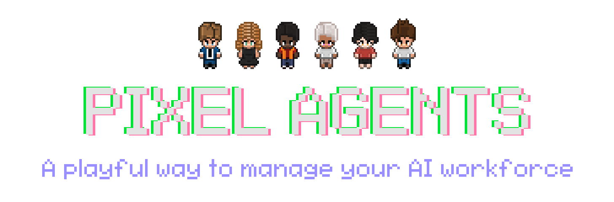
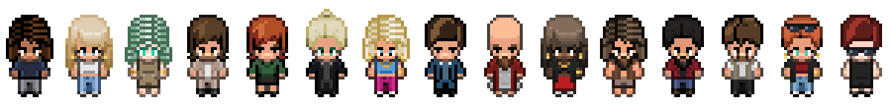

<h1 align="center">
  <a href="https://github.com/pixel-agents-hq/pixel-agents/discussions">
    
  </a>
</h1>
<div align="center">

[](https://github.com/pixel-agents-hq/pixel-agents/releases)
[](https://marketplace.visualstudio.com/items?itemName=pablodelucca.pixel-agents)
[](https://www.npmjs.com/package/pixel-agents)
[](https://github.com/pixel-agents-hq/pixel-agents/stargazers)
[](https://github.com/pixel-agents-hq/pixel-agents/blob/main/LICENSE)
[](https://discord.gg/Yk7jXebv9H)

</div>

<div align="center">
<a href="https://pixel-agents.com">🌐 Website</a> • <a href="https://marketplace.visualstudio.com/items?itemName=pablodelucca.pixel-agents">🛒 VS Code</a> • <a href="https://open-vsx.org/extension/pablodelucca/pixel-agents">🛒 Open VSX</a> • <a href="https://www.npmjs.com/package/pixel-agents">📦 npm</a> • <a href="https://discord.gg/Yk7jXebv9H">👾 Discord</a> • <a href="CONTRIBUTING.md">🤝 Contributing</a> • <a href="CHANGELOG.md">📋 Changelog</a>
</div>

<br/>

Pixel Agents turns the AI coding agents running in your terminals into animated pixel-art characters working in a tiny office. They walk to their desks, sit down, type when they're editing files, read when they're searching, and flag you visually when they're stuck waiting for input. The office is also where you run them: launch an agent into a project, pick its character, and see how much context it has left.

It ships in two forms from the same codebase:

- **Standalone CLI** — `npx pixel-agents` starts a local server and serves the same office as a browser app, useful for tmux, remote, and non-VS Code workflows.
- **VS Code extension** — [VS Code Marketplace](https://marketplace.visualstudio.com/items?itemName=pablodelucca.pixel-agents) and [Open VSX](https://open-vsx.org/extension/pablodelucca/pixel-agents). Agents launch into VS Code terminals; characters render in the panel area.

Claude Code is supported today; Codex, Gemini, Cursor, and others are on the roadmap. Want to add support for your favourite CLI? Join our [Discord](https://discord.gg/Yk7jXebv9H) and let us know!


## Features

- **One agent, one character** — every agent terminal gets its own animated character
- **Live activity tracking** — characters animate based on what the agent is actually doing (writing, reading, running commands). Sub-agents and teammates show up as their own characters
- **Notifications** — speech bubbles, plus optional chimes, when an agent needs input or permission or finishes its turn
- **Office layout editor** — design your office with floors, walls, furniture, and named Areas; layouts are saved across windows, export as JSON, and take external asset packs
- **Your own team** — design your agents: a wardrobe of bodies, hair, clothes and accessories, colour pickers, a pixel editor, and custom items. The pixel art is based on the amazing work of [JIK-A-4, Metro City](https://jik-a-4.itch.io/metrocity-free-topdown-character-pack).
- **In the browser and on your phone** — the standalone office launches agents into an embedded terminal. On a phone, via Tailscale, it can become an app with the office and the terminal a swipe apart
- **Recent conversations** — past sessions listed per Directory, resumed with one click as the character they had
- **Usage and context bars** — health bars for your plan limits, and one on every agent for the context it has left
- **Office radio** — procedural 8-bit background music with moods and shareable song codes

<p align="center">
  
</p>

## Requirements

- [Claude Code CLI](https://docs.anthropic.com/en/docs/claude-code) installed and configured
- **VS Code extension:** VS Code 1.105.0 or later
- **Standalone CLI:** Node.js 20 or later
- Windows, Linux, or macOS

## Getting Started

The VS Code extension and the standalone CLI can run side by side: both share the office layout but keep separate agents and settings.

### VS Code extension

1. Install Pixel Agents from the [VS Code Marketplace](https://marketplace.visualstudio.com/items?itemName=pablodelucca.pixel-agents) or [Open VSX](https://open-vsx.org/extension/pablodelucca/pixel-agents).
2. Open the **Pixel Agents** panel beside the terminal.
3. Click **+** (bottom left) to open its drawer of **Directories**, then click one to launch Claude Code in it. The drawer is empty at first: turn on **Settings → Show Workspace Folders**, or add a folder with **+ Directory** (see [Directories](#directories) below).

To use Claude with `--dangerously-skip-permissions`, turn on **Settings → Skip Permissions**. It stays on for every agent launched from that host until you turn it off. Only use this when you accept the security implications.

Pixel Agents also detects Claude sessions started outside the extension. Turn on **Settings → Watch All Sessions** to include sessions from other workspaces.

### Standalone CLI

Run Pixel Agents from anywhere:

```bash
npx pixel-agents
```

The CLI prints a local URL. Click **+** to open the drawer of Directories: add one with **+ Directory**, or turn on **Settings → Show Start Directory** to list the folder you started in. Pick a Directory to launch Claude Code in the browser's embedded terminal (on a phone, tap the **+** card). Sessions started in your own terminal show up too. To install globally:

```bash
npm install --global pixel-agents
pixel-agents
```

Use a fixed address or port when needed:

```bash
pixel-agents --port 3100
pixel-agents --host 127.0.0.1 --port 3100
pixel-agents --no-terminal
pixel-agents --help
```

The printed URL carries a `?token=`. Without it you can watch the office in a sort of read-only mode: no agents can be launched, terminals are not shown, and layout and settings cannot be edited. The token is kept in `~/.pixel-agents/standalone-token`, so a bookmark keeps working if you also fix `--port`. Treat the URL as a secret: whoever holds it can do all of the above.

### On your phone, via Tailscale

1. Install [Tailscale](https://tailscale.com/download) on the computer running Pixel Agents and on your phone, both signed in to the same tailnet.
2. Start the server on a fixed port, allowing the computer's tailnet name:

   ```bash
   pixel-agents --port 3100 --allowed-host my-computer.my-tailnet.ts.net
   ```

3. Serve it to your tailnet over HTTPS:

   ```bash
   tailscale serve --bg 3100
   ```

4. On your phone, open `https://my-computer.my-tailnet.ts.net/?token=…` (the `?token=` from the URL the CLI printed) and add it to the home screen. The fixed port keeps that shortcut working across restarts.

Only devices on your tailnet can reach it.

## Customizing the Office

### Layout

Click **Layout** to edit the office: paint floors, walls and carpets, place and recolour furniture, add pets you can click on, and paint named **Areas** that a Directory's agents prefer to sit in. Layouts can be exported and imported as JSON.

### Office assets

Use **Settings → Add Asset Directory** to load external characters, pets, and furniture. See [docs/external-assets.md](docs/external-assets.md) for furniture directory structure and manifest details. The visual asset manager at `scripts/asset-manager.html` helps create furniture manifests.

### Directories

A Directory is a folder you launch agents into. Click **+** to open the drawer, then **+ Directory** to add one: a name, a path (suggested from your past Claude Code sessions), and optionally the Areas its agents should sit in and the characters they wear by default. The pencil on a row you added edits or deletes it; on a phone, long-press the row.

Your workspace folders (VS Code) or the directory the CLI started in (standalone) are listed too once you turn on **Settings → Show Workspace Folders** or **Show Start Directory**.

### Characters

Open the roster from the arrow beside **+** and press a character's pencil (or **+ New**) to open the **Characters** view. Dress a character from the wardrobe tabs, recolour any piece, and touch up pixels in the editor; a piece you redraw can be saved as a custom item for the rest of the cast. Nothing changes in the office until you press **Save**. Characters export as a PNG or a config file, and the whole roster as a zip.

Picking a character in the roster and then a Directory launches an agent as that character. In a Directory's settings you can also list its default characters, so its agents are recognisable at a glance.

## Where This Is Going

The vision is to play a game and build a product. Two goals follow from it: to build a familiar, intuitive interface for running and orchestrating a lot of agents; and to make the hours you spend doing it feel less like administration and more like play.

Three things get there, and they are happening in parallel, not in sequence:

- **Actually a game.** Scores for whatever you care about. Furniture that _does_ things. Offices you open like save files, one per project.
- **Expand the orchestration frontier.** Embedded orchestration. Form a team by dragging a box around them. Hand work between agents. Point them at a board and let them pick up tasks themselves.
- **Everywhere, with everything.** Today it's Claude Code in VS Code or the browser. It should be whatever agent you run, wherever you work. A new CLI is a subdirectory, not a rewrite — this is where help is most useful right now.

Most of this is still ahead. See [Issues](https://github.com/pixel-agents-hq/pixel-agents/issues) and [Discussions](https://github.com/pixel-agents-hq/pixel-agents/discussions) for what's open, and [CONTRIBUTING.md](CONTRIBUTING.md) to jump in.

## How It Works

Pixel Agents uses two Claude Code detection paths:

- **Hooks mode** (default) — a hook script receives Claude events such as `SessionStart`, `PreToolUse`, `PermissionRequest`, and `Stop`. It discovers active Pixel Agents servers and sends authenticated events to each one.
- **Heuristic mode** (fallback) — when hooks are unavailable, the runtime infers agent status by scanning Claude's JSONL session transcripts under `~/.claude/projects/`. Transcripts are also read in hooks mode for details not present in an event.

Pixel Agents does not modify Claude Code. Its hook configuration and persistent data live under `~/.claude/` and `~/.pixel-agents/` respectively. The usage bars are opt-in (**Settings → Usage Bars**): Claude Code reports plan limits only to its status line, so turning them on wraps your `statusLine` command in `~/.claude/settings.json` (yours keeps running unchanged), and turning them off restores it.

## Development

To build from source, run the tests, or add support for another agent CLI, see [CONTRIBUTING.md](CONTRIBUTING.md). It covers setup, the project structure, how an event reaches the office, the asset format, and the hosted test reports. The end-to-end suite is described in [e2e/README.md](e2e/README.md).

## Troubleshooting

- **Standalone will not start:** verify Node.js 20+, omit `--port` to choose a free port, or select another fixed port.
- **An agent is missing:** confirm **Settings → Instant Detection (Hooks)** is on and that the session belongs to the current workspace. Enable **Watch All Sessions** if needed.
- **The UI looks disconnected:** open **Settings → Debug View** to inspect the server connection, transcript path, and latest agent data.
- **Extension and standalone are both running:** this is supported. Current versions create separate files under `~/.pixel-agents/servers/`; stopping one does not remove the other.

Still stuck? Ask in [Discord](https://discord.gg/Yk7jXebv9H) or open an [issue](https://github.com/pixel-agents-hq/pixel-agents/issues).

## Community & Contributing

Join the [Discord](https://discord.gg/Yk7jXebv9H) to chat with other users and follow development. Use [Issues](https://github.com/pixel-agents-hq/pixel-agents/issues) to report bugs or request features, and [Discussions](https://github.com/pixel-agents-hq/pixel-agents/discussions) for questions and ideas.

See [CONTRIBUTING.md](CONTRIBUTING.md) before opening a pull request and read our [Code of Conduct](CODE_OF_CONDUCT.md) before participating.

## Supporting the Project

<a href="https://github.com/sponsors/pablodelucca">
  
</a>
<a href="https://ko-fi.com/pablodelucca">
  
</a>

## Star History

<a href="https://www.star-history.com/?repos=pixel-agents-hq%2Fpixel-agents&type=date&legend=bottom-right">
 <picture>
   <source media="(prefers-color-scheme: dark)" srcset="https://api.star-history.com/chart?repos=pixel-agents-hq/pixel-agents&type=date&theme=dark&legend=bottom-right&sealed_token=Vn3YGMuZ_HFZAf56zIUQGCBJDYtDq38sOReKlcxWklxR_ilwVLynb7CPraf5uPhnAU7fwHXXoO88tzLkq9tpEYIExl4N8tcXOmu0ehAXPu5DdXNwjixYsxb00LSfeJ25f_jLkcZcTpRKLKYOb9p4_dR1jjAyrWDs7aicdbqejaDtLcVyj-oSoKkBfrS5" />
   <source media="(prefers-color-scheme: light)" srcset="https://api.star-history.com/chart?repos=pixel-agents-hq/pixel-agents&type=date&legend=bottom-right&sealed_token=Vn3YGMuZ_HFZAf56zIUQGCBJDYtDq38sOReKlcxWklxR_ilwVLynb7CPraf5uPhnAU7fwHXXoO88tzLkq9tpEYIExl4N8tcXOmu0ehAXPu5DdXNwjixYsxb00LSfeJ25f_jLkcZcTpRKLKYOb9p4_dR1jjAyrWDs7aicdbqejaDtLcVyj-oSoKkBfrS5" />
   
 </picture>
</a>

## License

Pixel Agents is available under the [MIT License](LICENSE).
