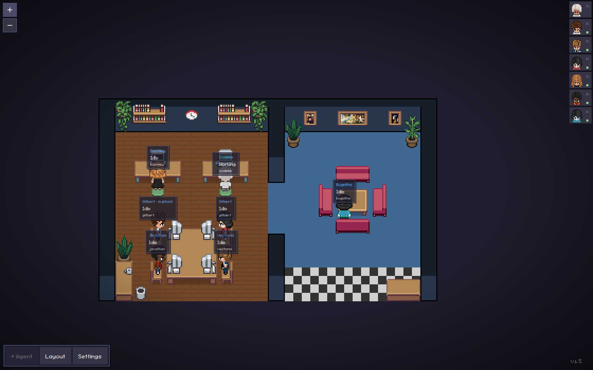

<h1 align="center">
  <a href="https://github.com/pixel-agents-hq/pixel-agents/discussions">
    
  </a>
</h1>

<h2 align="center">The most playful way to orchestrate your agents</h2>

<div align="center">

[](https://github.com/pixel-agents-hq/pixel-agents/releases)
[](https://marketplace.visualstudio.com/items?itemName=pablodelucca.pixel-agents)
[](https://www.npmjs.com/package/pixel-agents)
[](https://github.com/pixel-agents-hq/pixel-agents/stargazers)
[](https://github.com/pixel-agents-hq/pixel-agents/blob/main/LICENSE)
[](https://discord.gg/Yk7jXebv9H)

</div>

<div align="center">
<a href="https://marketplace.visualstudio.com/items?itemName=pablodelucca.pixel-agents">🛒 VS Code Marketplace</a> • <a href="https://open-vsx.org/extension/pablodelucca/pixel-agents">🛒 Open VSX</a> • <a href="https://www.npmjs.com/package/pixel-agents">📦 npm</a> • <a href="https://discord.gg/Yk7jXebv9H">👾 Discord</a> • <a href="https://github.com/pixel-agents-hq/pixel-agents/discussions">💬 Discussions</a> • <a href="CONTRIBUTING.md">🤝 Contributing</a> • <a href="CHANGELOG.md">📋 Changelog</a>
</div>

<br/>

Pixel Agents turns the AI coding agents running in your terminals into animated pixel-art characters working in a tiny office. They walk to their desks, sit down, type when they're editing files, read when they're searching, and flag you visually when they're stuck waiting for input.

> **OpenClaw integration branch:** this fork adds an experimental, metadata-only OpenClaw provider and a Gateway relay plugin, including remote offices, friendly names, and multi-session activity aggregation. This is not an upstream release announcement: the Marketplace/npm links below refer to the original project and do not necessarily contain these changes. [Build this fork and read the complete OpenClaw guide](docs/openclaw.md). Original Pixel Agents attribution, MIT license, and Claude Code workflows are retained.

It ships in two forms from the same codebase:

- **VS Code extension** — [VS Code Marketplace](https://marketplace.visualstudio.com/items?itemName=pablodelucca.pixel-agents) and [Open VSX](https://open-vsx.org/extension/pablodelucca/pixel-agents). Agents launch into VS Code terminals; characters render in the panel area.
- **Standalone CLI** — `npx pixel-agents` starts a local server and serves the same office as a browser app, useful for tmux, remote, and non-VS Code workflows.

The architecture is fully agent-agnostic and editor-agnostic: a typed `HookProvider` interface defines the integration boundary. Claude Code is the reference implementation, and an experimental OpenClaw provider can visualize local or remote OpenClaw activity without forwarding conversation content.


## Features

- **One agent, one character** — every Claude Code terminal or configured OpenClaw agent gets its own animated character
- **Live activity tracking** — characters animate based on what the agent is actually doing (writing, reading, running commands)
- **Office layout editor** — design your office with floors, walls, and furniture using a built-in editor
- **Speech bubbles** — visual indicators when an agent is waiting for input or awaiting permission
- **Sound notifications** — optional chimes when an agent finishes its turn or requests permission
- **Sub-agents and Agent Teams** — see ephemeral sub-agents and persistent Claude teammates as separate characters, including team roles and lifecycle changes
- **Persistent layouts** — your office design is saved and shared across VS Code windows
- **Shared layout and assets** — import/export layouts and load external character, pet, and furniture packs
- **Areas** — paint named areas onto the office, map workspace folders to them, and new agents sit inside the areas mapped to their folder
- **Diverse characters** — 6 diverse characters. These are based on the amazing work of [JIK-A-4, Metro City](https://jik-a-4.itch.io/metrocity-free-topdown-character-pack).

<p align="center">
  
</p>

## Where This Is Going

The vision is: play a game, build a product. Two goals follow from it: to build a familiar, intuitive interface for running and orchestrating a lot of agents; and to make the hours you spend doing it feel less like administration and more like play.

Roughly three stages get there:

1. **Everywhere, with everything.** Today it's Claude Code in VS Code or the browser. It should be whatever agent you run, wherever you work. A new CLI is a subdirectory, not a rewrite — this is where help is most useful right now.
2. **Actually a game.** Health bars for rate limits and token budgets. Scores for whatever you care about. Furniture that _does_ things. Offices you open like save files, one per project.
3. **Expand the orchestration frontier.** Orchestrator characters. Form a team by dragging a box around them. Hand work between agents. Point them at a board and let them pick up tasks themselves.

Most of this is still ahead. See [Issues](https://github.com/pixel-agents-hq/pixel-agents/issues) and [Discussions](https://github.com/pixel-agents-hq/pixel-agents/discussions) for what's open, and [CONTRIBUTING.md](CONTRIBUTING.md) to jump in.

## Requirements

- [Claude Code CLI](https://docs.anthropic.com/en/docs/claude-code) and/or [OpenClaw](https://github.com/openclaw/openclaw) installed and configured
- **VS Code extension:** VS Code 1.105.0 or later
- **Standalone CLI:** Node.js 20 or later
- Windows, Linux, or macOS

## Getting Started

### VS Code extension

1. Install Pixel Agents from the [VS Code Marketplace](https://marketplace.visualstudio.com/items?itemName=pablodelucca.pixel-agents) or [Open VSX](https://open-vsx.org/extension/pablodelucca/pixel-agents).
2. Open the **Pixel Agents** panel beside the terminal.
3. Click **+ Agent** to open its drawer of **Directories**, then click one to launch Claude Code in it. Your workspace folders are listed there once you turn on **Settings → Show Workspace Folders**; **+ Directory** adds your own (a name, a path, and optionally the Areas its agents should sit in), and the pencil on a row you added edits or deletes it.

To use Claude with `--dangerously-skip-permissions`, turn on **Settings → Skip Permissions**. It stays on for every agent launched from that host until you turn it off. Only use this when you accept the security implications.

Pixel Agents also detects Claude sessions started outside the extension. Turn on **Settings → Watch All Sessions** to include sessions from other workspaces.

### Standalone CLI

Run Pixel Agents from the workspace whose Claude sessions you want to see:

```bash
cd /path/to/your/project
npx pixel-agents
```

The CLI chooses a free local port and prints the URL. Click **+ Agent** to open the Directory drawer and click a Directory to launch Claude Code in it; the agent's terminal opens in the browser. **+ Directory** adds your own, and **Settings → Show Start Directory** lists the directory the CLI was started from. On a phone, tap the **+** card to open the same drawer and tap a Directory to launch (long-press a Directory you added to edit it). Claude Code started in your own terminal is picked up too. To install the command globally instead:

```bash
npm install --global pixel-agents
pixel-agents
```

Use a fixed address or port when needed:

```bash
pixel-agents --port 3100
pixel-agents --host 127.0.0.1 --port 3100
pixel-agents --no-terminal
pixel-agents --help
```

The default bind address is `127.0.0.1`. Binding to `0.0.0.0` exposes the UI and WebSocket to the local network; do this only on a trusted network.

Open the URL the CLI prints - it carries a `?token=` for this server. Any browser can watch the office without it, but installing or removing hooks (which edits your agent tool's own settings file, like the `~/.claude/settings.json`), launching agents from the browser and attaching to their terminals are only offered to a session that has the token, so an untokened client on the network cannot approve or do any of it. Open the bare address instead and the hooks toggle in Settings is refused (reporting the actual install state rather than appearing to work) and the **+ Agent** button explains what it needs. Standalone keeps the same token across restarts (in `~/.pixel-agents/standalone-token`, readable only by you), so a bookmarked or home-screen URL keeps working — as long as the port stays the same too, which takes `--port` (the default port is picked fresh on every start).

Treat that URL as a secret: the token is a bearer capability, not proof of being local. Whoever holds it can approve the hook install from anywhere the server is reachable — so don't paste the URL into a shared channel, and note that it also lands in your browser history (the server's own request log redacts it).

Pass `--no-terminal` to disable the embedded terminal — watch agents without launching or attaching to them from the browser.

Copying from the embedded terminal is verbatim: Cmd+C (Mac), Ctrl+C or Ctrl+Shift+C with a selection (Windows, Linux), the browser's Copy, and the **Copy** button on a phone copy exactly what is on screen. Claude Code wraps long prose into lines indented two spaces; to copy such a passage as flowing text instead, select it and press **Alt+C** (**Option+C** on a Mac), or tap **Copy as text** on a phone. On a phone opened over plain `http://` (a LAN address), the paste key asks for the text in a prompt, since the page cannot read the clipboard there.

### Running the extension and standalone together

The extension and standalone CLI can run at the same time. Each server registers under `~/.pixel-agents/servers/`; the hook script sends events to all active registrations. VS Code and standalone keep separate agents, seats, and settings while using the shared office layout.

Stop a standalone server with **Ctrl+C**. It removes only its own registration.

### Experimental OpenClaw support

When Pixel Agents starts, it can offer to install its bundled OpenClaw relay plugin. Accepting that provider-specific consent prompt runs OpenClaw's normal plugin installer and links a copy stored under `~/.pixel-agents/openclaw-plugin/`. Restart the OpenClaw gateway if OpenClaw asks you to do so.

Start the VS Code extension or standalone CLI, then use OpenClaw normally in a tracked workspace. Each configured OpenClaw agent has one hooks-only character per Gateway, shared across its ordinary chat sessions. Different configured agents remain separate. Across simultaneous chats the visible priority is **working/generating > tool activity > reading/research > idle**; the most recently updated session wins ties. Finishing one session cannot idle or remove a character while another session is working. Genuine delegated child sessions remain distinct, labeled as subtasks, and close on native child-completion metadata. The base UI's spawn-tool character behavior remains enabled and unchanged. Pixel Agents does not launch or attach to OpenClaw sessions.

**Child-only inactivity cleanup:** with relay v1.2.0 and this office build, explicitly marked child-session characters also despawn after **two minutes without activity**. Normal configured agents never expire for being idle, regardless of their display names. This is a visualization lease, not task cancellation; later child activity can re-adopt the character.

The relay is deliberately content-free. It sends only an opaque Gateway/agent identifier, hashed tool identifiers, configured display names, tool names, lifecycle state, and the active workspace directory. Session arbitration stays in the Gateway relay. It never sends prompts, responses, message bodies, tool parameters, tool results, credentials, tokens, or transcript content. To disconnect, uninstall `pixel-agents-openclaw` through OpenClaw on the Gateway host/profile; the existing office Instant Detection toggle controls Claude Code, not the relay.

Names come from the agent's OpenClaw `identity.name`, then its configured `name`, then its agent ID—never Discord or another channel. Optional manual overrides live in the OpenClaw plugin settings at `plugins.entries.pixel-agents-openclaw.config.agentNames`, for example `{"main":"Avery","builder":"Blake"}`. These overrides take precedence. For multiple Gateways on the same host/state location, set a unique stable `config.gatewayId` for each; the default namespace uses the hostname and OpenClaw state/config location. Namespace and agent IDs are hashed before delivery.

By default the plugin discovers authenticated Pixel Agents servers for the same OS user and delivers events over loopback. Pixel Agents and OpenClaw do not have to share a host, though: the plugin can also send to one configured remote office using a dedicated hook-only bearer credential. That credential cannot control the Pixel Agents UI, install hooks, launch agents, or attach to terminals.

On the Pixel Agents host, run the standalone server on a stable port and place it behind HTTPS (Tailscale Serve or another TLS reverse proxy is recommended). Pixel Agents creates the remote credential at `~/.pixel-agents/relay-token` with mode `0600`; copy its value into an OpenClaw secret provider rather than placing it directly in configuration. Then configure the plugin entry along these lines:

```json
{
  "plugins": {
    "entries": {
      "pixel-agents-openclaw": {
        "enabled": true,
        "config": {
          "localDiscovery": false,
          "remote": {
            "endpoint": "https://pixel-agents.example/api/hooks/openclaw",
            "token": {
              "source": "store",
              "provider": "default",
              "id": "PIXEL_AGENTS_RELAY_TOKEN"
            }
          }
        }
      }
    }
  }
}
```

The endpoint must be the final `/api/hooks/openclaw` URL. HTTPS is required for non-loopback destinations and redirects are refused. Delivery is best-effort, with a two-second timeout per HTTP request; hooks await delivery, so a slow office can add latency. There is no durable delivery queue or replay. Leave `localDiscovery` unset (or `true`) to deliver to local servers as well. To revoke the remote credential, stop every Pixel Agents server and restart one with `--rotate-relay-token`, then update the OpenClaw secret and reload its gateway.

See the [complete OpenClaw guide](docs/openclaw.md) for fork installation, the session/status model, configuration reference, child behavior, privacy, troubleshooting, limitations, and verification instructions.



Live remote OpenClaw office, captured on October 25, 2026: six configured agents plus Gitbert's separately identified child session. Friendly names and current activity labels come from the running integration, not synthetic test events. The earlier synthetic fixture remains available in `docs/images/openclaw-office.png` for comparison.

## Customizing the Office

Click **Layout** to edit the office:

- Paint floor patterns and walls, with color and contrast controls.
- Place, rotate, recolor, select, and remove furniture.
- Paint auto-tiling carpets and customize their main and accent colors.
- Add animated pets; click a pet in the office to interact with it.
- Create named **Areas**, paint their tiles, and assign Directories to them (agents launched in a Directory prefer seats in its Areas).
- Undo/redo changes, then import or export the complete layout as JSON.

Layouts can grow to 64×64 tiles by clicking the ghost border outside the current grid.

### Office assets

Bundled furniture, floors, walls, carpets, characters, and pets live under `webview-ui/public/assets/`. Furniture manifests describe sprites, rotation groups, state groups, and animation frames.

Use **Settings → Add Asset Directory** to load external characters, pets, and furniture. See [docs/external-assets.md](docs/external-assets.md) for furniture directory structure and manifest details. The visual asset manager at `scripts/asset-manager.html` helps create furniture manifests.

## How It Works

Pixel Agents uses two Claude Code detection paths:

- **Hooks mode** (default) — a hook script receives Claude events such as `SessionStart`, `PreToolUse`, `PermissionRequest`, and `Stop`. It discovers active Pixel Agents servers and sends authenticated events to each one.
- **Heuristic mode** (fallback) — when hooks are unavailable, the runtime infers agent status by scanning Claude's JSONL session transcripts under `~/.claude/projects/`. Transcripts are also read in hooks mode for details not present in an event.

The OpenClaw provider uses a bundled local plugin and typed OpenClaw lifecycle hooks. It has no transcript fallback and intentionally forwards no conversation or tool payload content.

Each provider normalizes its source events into a shared `AgentEvent` model. `AgentRuntime` routes events by provider, updates the central state store, and the active transport sends typed messages to the React webview. The office renders through Canvas 2D with pathfinding and character state machines.

Pixel Agents does not modify Claude Code. Its hook configuration and persistent data live under `~/.claude/` and `~/.pixel-agents/` respectively.

### Architecture

- **`core/`** — provider, adapter, transport, schema, and AsyncAPI message contracts with no runtime side effects.
- **`server/`** — shared Fastify server, provider-aware agent runtime, persistence, provider implementations, transcript scanning, and standalone CLI.
- **`integrations/openclaw/`** — the content-free OpenClaw lifecycle relay bundled with Pixel Agents.
- **`adapters/vscode/`** — the VS Code adapter: terminal, persistence, and webview bridge.
- **`webview-ui/`** — React 19, Vite, Canvas 2D, and adapter-specific transports for VS Code and browser WebSocket clients.

The extension and CLI are bundled with esbuild; the webview is built with Vite. Unit tests use Vitest and Node's test runner, and end-to-end coverage uses Playwright against VS Code and standalone.

## Development

```bash
git clone https://github.com/pixel-agents-hq/pixel-agents.git
cd pixel-agents
npm install
npm run build
```

Press **F5** in VS Code to launch the Extension Development Host. To run the standalone bundle built from source:

```bash
node dist/cli.js
```

Common checks:

```bash
npm run check-types
npm run lint
npm test
npm run e2e
```

See [CONTRIBUTING.md](CONTRIBUTING.md) for the development workflow and [e2e/README.md](e2e/README.md) for the end-to-end suite.

### Hosted Test Reports

Build the combined Allure report locally and stage it for Vercel:

```bash
npm run test
npm run e2e
npm run e2e -- --attach-videos-on-success
npm run vercel:prepare
```

Use `npm run test:report` to build the combined report without preparing the Vercel output, then `npm run test:report:open` to serve it locally.

The staged output serves the combined `e2e`, `server`, and `webview` Allure report at `/reports/allure/`; it does not include a standalone webview preview. GitHub Actions creates a Vercel Preview deployment only for same-repository pull requests targeting `main`. The deploy job expects `VERCEL_TOKEN`, `VERCEL_ORG_ID`, and `VERCEL_PROJECT_ID` secrets and skips fork pull requests.

## Troubleshooting

- **Standalone will not start:** verify Node.js 20+, omit `--port` to choose a free port, or select another fixed port.
- **An agent is missing:** confirm **Settings → Instant Detection (Hooks)** is on and that the session belongs to the current workspace. Enable **Watch All Sessions** if needed.
- **An OpenClaw session is missing:** confirm the OpenClaw consent prompt was accepted, run `openclaw plugins list --json` and look for the loaded `pixel-agents-openclaw` plugin, then restart the gateway if the installer requested it.
- **The UI looks disconnected:** open **Settings → Debug View** to inspect the server connection, transcript path, and latest agent data.
- **Extension and standalone are both running:** this is supported. Current versions create separate files under `~/.pixel-agents/servers/`; stopping one does not remove the other.

## Community & Contributing

Join the [Discord](https://discord.gg/Yk7jXebv9H) to chat with other users and follow development. Use [Issues](https://github.com/pixel-agents-hq/pixel-agents/issues) to report bugs or request features, and [Discussions](https://github.com/pixel-agents-hq/pixel-agents/discussions) for questions and ideas.

See [CONTRIBUTING.md](CONTRIBUTING.md) before opening a pull request and read our [Code of Conduct](CODE_OF_CONDUCT.md) before participating.

## Supporting the Project

<a href="https://github.com/sponsors/pablodelucca">
  
</a>
<a href="https://ko-fi.com/pablodelucca">
  
</a>

## Star History

<a href="https://www.star-history.com/?repos=pixel-agents-hq%2Fpixel-agents&type=date&legend=bottom-right">
 <picture>
   <source media="(prefers-color-scheme: dark)" srcset="https://api.star-history.com/chart?repos=pixel-agents-hq/pixel-agents&type=date&theme=dark&legend=bottom-right&sealed_token=Vn3YGMuZ_HFZAf56zIUQGCBJDYtDq38sOReKlcxWklxR_ilwVLynb7CPraf5uPhnAU7fwHXXoO88tzLkq9tpEYIExl4N8tcXOmu0ehAXPu5DdXNwjixYsxb00LSfeJ25f_jLkcZcTpRKLKYOb9p4_dR1jjAyrWDs7aicdbqejaDtLcVyj-oSoKkBfrS5" />
   <source media="(prefers-color-scheme: light)" srcset="https://api.star-history.com/chart?repos=pixel-agents-hq/pixel-agents&type=date&legend=bottom-right&sealed_token=Vn3YGMuZ_HFZAf56zIUQGCBJDYtDq38sOReKlcxWklxR_ilwVLynb7CPraf5uPhnAU7fwHXXoO88tzLkq9tpEYIExl4N8tcXOmu0ehAXPu5DdXNwjixYsxb00LSfeJ25f_jLkcZcTpRKLKYOb9p4_dR1jjAyrWDs7aicdbqejaDtLcVyj-oSoKkBfrS5" />
   
 </picture>
</a>

## License

Pixel Agents is available under the [MIT License](LICENSE).
