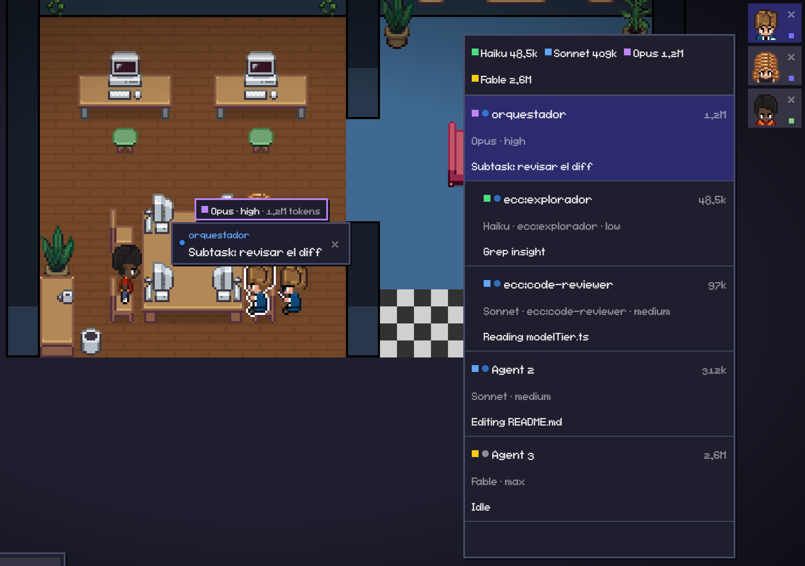
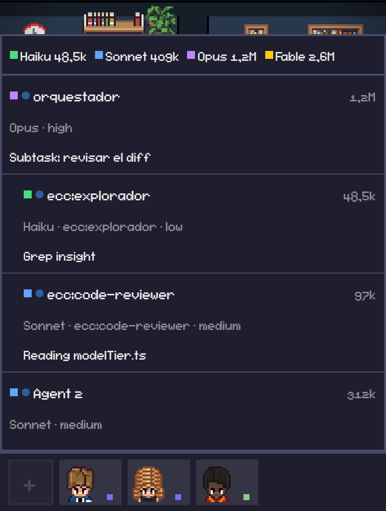

# Nakama Works

**Nakama Works** es un fork de [Pixel Agents](https://github.com/pixel-agents-hq/pixel-agents) para ver **la cascada de agentes en vivo**. Muestra qué modelo usa cada agente y subagente (Haiku, Sonnet, Opus, Fable, Codex), con qué tipo y effort se lanzó, qué está pensando y cuántos tokens lleva gastados.

Todo se lee de los transcripts que Claude Code ya guarda en `~/.claude/projects`, así que **mirar no gasta tokens**.

_Nakama_ (仲間) significa "compañeros de equipo".

> 🚧 En construcción. El avance está en los [pull requests](https://github.com/B3njjaman/nakama-works/pulls?q=is%3Apr).

<p align="center">
  
</p>

<sub>Captura con una cascada de ejemplo: un orquestador Opus que encarga a un explorador Haiku y a un revisor Sonnet.</sub>

## Qué agrega a Pixel Agents

| Función               | Qué ves                                                                                                      | Estado          |
| --------------------- | ------------------------------------------------------------------------------------------------------------ | --------------- |
| Color por modelo      | Cada personaje con el color de su modelo: Haiku verde, Sonnet azul, Opus morado, Fable dorado, Codex naranja | Listo           |
| Tipo, effort y tokens | Insignia `Sonnet · ecc:constructor · high · 1,2M tokens` sobre el personaje                                  | Listo           |
| Pensamiento           | Burbuja con lo último que pensó el agente; se puede ocultar al compartir la oficina                          | Listo           |
| Quién encarga a quién | Línea punteada de cada subagente a su agente                                                                 | Listo           |
| Panel de cascada      | Totales por modelo y árbol de agentes y subagentes con modelo, effort, estado, gasto y última acción         | Listo           |
| Barra de sesión       | En la consola: modelo, effort, contexto, límites de 5 h y 7 días y costo                                     | Listo           |
| Nakamas por modelo    | Tus propios personajes, cada uno reservado para un modelo                                                    | En construcción |

## Cómo usarlo

`npx pixel-agents` instala el Pixel Agents original, no este fork. Para usar Nakama Works hay que armarlo desde el código (Node.js 20 o más nuevo):

```bash
git clone https://github.com/B3njjaman/nakama-works.git
cd nakama-works
npm install
npm run build
node dist/cli.js --port 3100
```

Abre la URL que imprime: trae un `?token=` que te deja lanzar agentes y cambiar ajustes. Si abres `http://127.0.0.1:3100/` sin el token, la oficina queda **solo para mirar**. Esa es la versión que conviene compartir. Con `--no-terminal` el navegador no abre terminales.

Desde VS Code, abre la carpeta y presiona **F5** para lanzar la extensión desde el código.

## Panel de cascada

El botón **Cascade** abre el panel. Arriba muestra cuántos tokens lleva cada modelo. Debajo, cada agente con sus subagentes anidados: color del modelo, estado, nombre, tokens, insignia y última acción. Al tocar una fila, la cámara sigue a ese agente.

- En escritorio es un panel lateral que recuerda si lo dejaste abierto.
- En el celular es una hoja que sube desde abajo.
- También está en la oficina de solo lectura.
- Cerrado no consume nada; abierto se refresca cuatro veces por segundo.

<p align="center">
  
</p>

## Gasto de tokens

Cada agente y subagente suma lo que leen sus transcripts: tokens de entrada y de salida, más los de caché, que son el contexto que el modelo vuelve a leer en cada turno. Por eso la cifra crece más rápido que el texto que ves. La cuenta parte cuando la oficina empieza a mirar al agente. Se muestra con coma decimal y sufijos (`48,5k`, `1,2M`), y si el gasto es 0 no aparece.

## Pensamiento

Claude Code guarda el pensamiento cifrado a menos que se lo pidas. Agrega esto a `~/.claude/settings.json`:

```json
{ "showThinkingSummaries": true }
```

Según la [documentación oficial](https://code.claude.com/docs/en/settings-reference.md), esto cambia solo lo que se ve, no lo que el modelo genera. Lo que aparece es un **resumen** del pensamiento.

Para compartir la oficina sin mostrarlo, apaga **Settings → Show Agent Thinking**. Apagado, el servidor deja de mandar el pensamiento a todos los clientes y tampoco lo guarda. Al volver a encenderlo no reenvía pensamientos viejos.

## Barra de sesión

Una línea bajo el prompt de cada consola, armada con el [`statusLine`](https://code.claude.com/docs/en/statusline.md) de Claude Code:

```
Opus 5.5 xhigh · ctx 34% · 5h ▰▰▰▱▱ 62% ↺21:40 · 7d ▰▱▱▱▱ 18% ↺lun 09:00 · $1.23
```

Muestra el modelo y el effort, el contexto usado, los límites de 5 horas y de 7 días (en verde, amarillo o rojo, con la hora en que se reinician) y el costo de la sesión. Los límites solo aparecen en los planes Pro y Max, después de la primera respuesta. No gasta tokens ni usa la red.

Para instalarla, después de `npm run build` copia `dist/hooks/nakama-statusline.js` a `~/.pixel-agents/statusline/` y agrega esto a `~/.claude/settings.json` (con la ruta de tu carpeta de usuario):

```json
{
  "statusLine": {
    "type": "command",
    "command": "node \"C:/Users/<tu-usuario>/.pixel-agents/statusline/nakama-statusline.js\"",
    "padding": 0
  }
}
```

Además deja datos para la oficina en `~/.pixel-agents/statusline/`, legibles solo por ti: un archivo por consola y el uso combinado de todas. Nunca guarda la ruta del transcript.

## Nakamas por modelo

Tus propios personajes reemplazan a los de la oficina, y cada colección queda reservada para un modelo. Así ves de un vistazo si un trabajo lo está haciendo Haiku, Sonnet, Opus o Fable.

- El agente aparece como un personaje normal y, cuando se sabe su modelo, se transforma en un Nakama de ese modelo con el mismo efecto de aparición.
- Sale de las colecciones de su modelo o de las que no tienen modelo. Entre esos, el menos usado; si hay empate, uno al azar.
- Un agente de Codex, o un modelo que no tiene colección, puede salir con cualquier Nakama.

Se cargan con **Settings → Add Asset Directory**, apuntando a una carpeta con esta forma:

```
<tu carpeta>/assets/nakamas/
  modelos.json
  <colección>/
    <personaje>/
      <personaje>_F.png   frente
      <personaje>_B.png   espalda
      <personaje>_L.png   mirando a la izquierda
      <personaje>_R.png   mirando a la derecha
      posiciones.json     opcional: { "personaje": "Nombre para mostrar" }
```

Las poses pueden ser de cualquier tamaño, con fondo blanco. Se convierten solas a sprites de 32 px de alto (y hasta 32 de ancho), todas con la misma escala y los pies en el suelo. Las carpetas que empiezan con `_` se ignoran. `modelos.json` dice para qué modelo es cada colección (`haiku`, `sonnet`, `opus`, `fable`, o `null` para cualquiera), y se puede mover un personaje suelto:

```json
{
  "colecciones": { "mi_coleccion": "opus", "otra_coleccion": null },
  "personajes": { "otra_coleccion/Mi_Personaje": "haiku" }
}
```

Estado: el índice, el convertidor y el contrato ya están en `main` ([#11](https://github.com/B3njjaman/nakama-works/pull/11)). La asignación en el servidor y el dibujo en la oficina están en revisión. Los sprites de personajes con derechos de autor no se suben a este repo.

## Lo que viene

- Hablarle a cada consola desde la oficina, como si escribieras en esa terminal, sin gastar tokens extra.
- La barra de sesión dentro de la oficina, con el uso combinado de todas las consolas.
- Un taller del harness: qué skills, agentes, plugins, hooks y servidores MCP hay instalados, y cuáles usa cada consola.
- Comparar métodos: qué nivel de la cascada, tipo de agente o skill rinde mejor por token gastado.

## Créditos y gracias

Gracias a Pablo De Lucca y a todos los que construyeron [Pixel Agents](https://github.com/pixel-agents-hq/pixel-agents). Sin su oficina, sus personajes y su lector de transcripts, Nakama Works no existiría. Gracias también a los autores de Agent Flow, claude-esp, Agents Observe y claude-devtools: sus ideas guiaron la vista de cascada.

- [Pixel Agents](https://github.com/pixel-agents-hq/pixel-agents) de Pablo De Lucca y sus colaboradores (MIT) es la base completa: la oficina, los personajes, los hooks y el lector de transcripts. Su licencia se mantiene en [LICENSE](LICENSE).
- Estas herramientas inspiraron las funciones nuevas. Se tomaron ideas, no código:
  - [Agent Flow](https://github.com/patoles/agent-flow) (Apache-2.0): el modelo de cada subagente y el grafo de quién llama a quién.
  - [claude-esp](https://github.com/phiat/claude-esp) (MIT): el pensamiento y el contexto por agente en vivo.
  - [Agents Observe](https://github.com/simple10/agents-observe) (MIT): la jerarquía de subagentes y la línea de tiempo.
  - [claude-devtools](https://github.com/matt1398/claude-devtools) (MIT): el gasto de tokens por subagente.

Lo que sigue es el README original de Pixel Agents, sin cambios. Sus instrucciones de instalación (`npx pixel-agents`, el Marketplace) son las del proyecto original; para este fork, ver [Cómo usarlo](#cómo-usarlo).

---

<h1 align="center">
  <a href="https://github.com/pixel-agents-hq/pixel-agents/discussions">
    
  </a>
</h1>

<h2 align="center">The most playful way to orchestrate your agents</h2>

<div align="center">

[](https://github.com/pixel-agents-hq/pixel-agents/releases)
[](https://marketplace.visualstudio.com/items?itemName=pablodelucca.pixel-agents)
[](https://www.npmjs.com/package/pixel-agents)
[](https://github.com/pixel-agents-hq/pixel-agents/stargazers)
[](https://github.com/pixel-agents-hq/pixel-agents/blob/main/LICENSE)
[](https://discord.gg/Yk7jXebv9H)

</div>

<div align="center">
<a href="https://marketplace.visualstudio.com/items?itemName=pablodelucca.pixel-agents">🛒 VS Code Marketplace</a> • <a href="https://open-vsx.org/extension/pablodelucca/pixel-agents">🛒 Open VSX</a> • <a href="https://www.npmjs.com/package/pixel-agents">📦 npm</a> • <a href="https://discord.gg/Yk7jXebv9H">👾 Discord</a> • <a href="https://github.com/pixel-agents-hq/pixel-agents/discussions">💬 Discussions</a> • <a href="CONTRIBUTING.md">🤝 Contributing</a> • <a href="CHANGELOG.md">📋 Changelog</a>
</div>

<br/>

Pixel Agents turns the AI coding agents running in your terminals into animated pixel-art characters working in a tiny office. They walk to their desks, sit down, type when they're editing files, read when they're searching, and flag you visually when they're stuck waiting for input.

It ships in two forms from the same codebase:

- **VS Code extension** — [VS Code Marketplace](https://marketplace.visualstudio.com/items?itemName=pablodelucca.pixel-agents) and [Open VSX](https://open-vsx.org/extension/pablodelucca/pixel-agents). Agents launch into VS Code terminals; characters render in the panel area.
- **Standalone CLI** — `npx pixel-agents` starts a local server and serves the same office as a browser app, useful for tmux, remote, and non-VS Code workflows.

The architecture is fully agent-agnostic and editor-agnostic: a typed `HookProvider` interface defines the integration boundary so adding a new AI tool is a single subdirectory of code. Claude Code is the reference implementation today; Codex, Gemini, Cursor, and others are on the roadmap.


## Features

- **One agent, one character** — every Claude Code terminal gets its own animated character
- **Live activity tracking** — characters animate based on what the agent is actually doing (writing, reading, running commands)
- **Office layout editor** — design your office with floors, walls, and furniture using a built-in editor
- **Speech bubbles** — visual indicators when an agent is waiting for input or awaiting permission
- **Sound notifications** — optional chimes when an agent finishes its turn or requests permission
- **Sub-agents and Agent Teams** — see ephemeral sub-agents and persistent Claude teammates as separate characters, including team roles and lifecycle changes
- **Persistent layouts** — your office design is saved and shared across VS Code windows
- **Shared layout and assets** — import/export layouts and load external character, pet, and furniture packs
- **Areas** — paint named areas onto the office, map workspace folders to them, and new agents sit inside the areas mapped to their folder
- **Diverse characters** — 6 diverse characters. These are based on the amazing work of [JIK-A-4, Metro City](https://jik-a-4.itch.io/metrocity-free-topdown-character-pack).

<p align="center">
  
</p>

## Where This Is Going

The vision is: play a game, build a product. Two goals follow from it: to build a familiar, intuitive interface for running and orchestrating a lot of agents; and to make the hours you spend doing it feel less like administration and more like play.

Roughly three stages get there:

1. **Everywhere, with everything.** Today it's Claude Code in VS Code or the browser. It should be whatever agent you run, wherever you work. A new CLI is a subdirectory, not a rewrite — this is where help is most useful right now.
2. **Actually a game.** Health bars for rate limits and token budgets. Scores for whatever you care about. Furniture that _does_ things. Offices you open like save files, one per project.
3. **Expand the orchestration frontier.** Orchestrator characters. Form a team by dragging a box around them. Hand work between agents. Point them at a board and let them pick up tasks themselves.

Most of this is still ahead. See [Issues](https://github.com/pixel-agents-hq/pixel-agents/issues) and [Discussions](https://github.com/pixel-agents-hq/pixel-agents/discussions) for what's open, and [CONTRIBUTING.md](CONTRIBUTING.md) to jump in.

## Requirements

- [Claude Code CLI](https://docs.anthropic.com/en/docs/claude-code) installed and configured
- **VS Code extension:** VS Code 1.105.0 or later
- **Standalone CLI:** Node.js 20 or later
- Windows, Linux, or macOS

## Getting Started

### VS Code extension

1. Install Pixel Agents from the [VS Code Marketplace](https://marketplace.visualstudio.com/items?itemName=pablodelucca.pixel-agents) or [Open VSX](https://open-vsx.org/extension/pablodelucca/pixel-agents).
2. Open the **Pixel Agents** panel beside the terminal.
3. Click **+ Agent** to open its drawer of **Directories**, then click one to launch Claude Code in it. Your workspace folders are listed there once you turn on **Settings → Show Workspace Folders**; **+ Directory** adds your own (a name, a path, and optionally the Areas its agents should sit in), and the pencil on a row you added edits or deletes it.

To use Claude with `--dangerously-skip-permissions`, turn on **Settings → Skip Permissions**. It stays on for every agent launched from that host until you turn it off. Only use this when you accept the security implications.

Pixel Agents also detects Claude sessions started outside the extension. Turn on **Settings → Watch All Sessions** to include sessions from other workspaces.

### Standalone CLI

Run Pixel Agents from the workspace whose Claude sessions you want to see:

```bash
cd /path/to/your/project
npx pixel-agents
```

The CLI chooses a free local port and prints the URL. Click **+ Agent** to open the Directory drawer and click a Directory to launch Claude Code in it; the agent's terminal opens in the browser. **+ Directory** adds your own, and **Settings → Show Start Directory** lists the directory the CLI was started from. On a phone, tap the **+** card to open the same drawer and tap a Directory to launch (long-press a Directory you added to edit it). Claude Code started in your own terminal is picked up too. To install the command globally instead:

```bash
npm install --global pixel-agents
pixel-agents
```

Use a fixed address or port when needed:

```bash
pixel-agents --port 3100
pixel-agents --host 127.0.0.1 --port 3100
pixel-agents --no-terminal
pixel-agents --help
```

The default bind address is `127.0.0.1`. Binding to `0.0.0.0` exposes the UI and WebSocket to the local network; do this only on a trusted network.

Open the URL the CLI prints - it carries a `?token=` for this server. Any browser can watch the office without it, but installing or removing hooks (which edits your agent tool's own settings file, like the `~/.claude/settings.json`), launching agents from the browser and attaching to their terminals are only offered to a session that has the token, so an untokened client on the network cannot approve or do any of it. Open the bare address instead and the hooks toggle in Settings is refused (reporting the actual install state rather than appearing to work) and the **+ Agent** button explains what it needs. Standalone keeps the same token across restarts (in `~/.pixel-agents/standalone-token`, readable only by you), so a bookmarked or home-screen URL keeps working — as long as the port stays the same too, which takes `--port` (the default port is picked fresh on every start).

Treat that URL as a secret: the token is a bearer capability, not proof of being local. Whoever holds it can approve the hook install from anywhere the server is reachable — so don't paste the URL into a shared channel, and note that it also lands in your browser history (the server's own request log redacts it).

Pass `--no-terminal` to disable the embedded terminal — watch agents without launching or attaching to them from the browser.

Copying from the embedded terminal is verbatim: Cmd+C (Mac), Ctrl+C or Ctrl+Shift+C with a selection (Windows, Linux), the browser's Copy, and the **Copy** button on a phone copy exactly what is on screen. Claude Code wraps long prose into lines indented two spaces; to copy such a passage as flowing text instead, select it and press **Alt+C** (**Option+C** on a Mac), or tap **Copy as text** on a phone. On a phone opened over plain `http://` (a LAN address), the paste key asks for the text in a prompt, since the page cannot read the clipboard there.

### Running the extension and standalone together

The extension and standalone CLI can run at the same time. Each server registers under `~/.pixel-agents/servers/`; the hook script sends events to all active registrations. VS Code and standalone keep separate agents, seats, and settings while using the shared office layout.

Stop a standalone server with **Ctrl+C**. It removes only its own registration.

## Customizing the Office

Click **Layout** to edit the office:

- Paint floor patterns and walls, with color and contrast controls.
- Place, rotate, recolor, select, and remove furniture.
- Paint auto-tiling carpets and customize their main and accent colors.
- Add animated pets; click a pet in the office to interact with it.
- Create named **Areas**, paint their tiles, and assign Directories to them (agents launched in a Directory prefer seats in its Areas).
- Undo/redo changes, then import or export the complete layout as JSON.

Layouts can grow to 64×64 tiles by clicking the ghost border outside the current grid.

### Office assets

Bundled furniture, floors, walls, carpets, characters, and pets live under `webview-ui/public/assets/`. Furniture manifests describe sprites, rotation groups, state groups, and animation frames.

Use **Settings → Add Asset Directory** to load external characters, pets, and furniture. See [docs/external-assets.md](docs/external-assets.md) for furniture directory structure and manifest details. The visual asset manager at `scripts/asset-manager.html` helps create furniture manifests.

## How It Works

Pixel Agents uses two Claude Code detection paths:

- **Hooks mode** (default) — a hook script receives Claude events such as `SessionStart`, `PreToolUse`, `PermissionRequest`, and `Stop`. It discovers active Pixel Agents servers and sends authenticated events to each one.
- **Heuristic mode** (fallback) — when hooks are unavailable, the runtime infers agent status by scanning Claude's JSONL session transcripts under `~/.claude/projects/`. Transcripts are also read in hooks mode for details not present in an event.

The Claude provider normalizes both sources into a shared `AgentEvent` model. `AgentRuntime` updates the central state store, and the active transport sends typed messages to the React webview. The office renders through Canvas 2D with pathfinding and character state machines.

Pixel Agents does not modify Claude Code. Its hook configuration and persistent data live under `~/.claude/` and `~/.pixel-agents/` respectively.

### Architecture

- **`core/`** — provider, adapter, transport, schema, and AsyncAPI message contracts with no runtime side effects.
- **`server/`** — shared Fastify server, agent runtime, persistence, Claude provider, transcript scanning, and standalone CLI.
- **`adapters/vscode/`** — the VS Code adapter: terminal, persistence, and webview bridge.
- **`webview-ui/`** — React 19, Vite, Canvas 2D, and adapter-specific transports for VS Code and browser WebSocket clients.

The extension and CLI are bundled with esbuild; the webview is built with Vite. Unit tests use Vitest and Node's test runner, and end-to-end coverage uses Playwright against VS Code and standalone.

## Development

```bash
git clone https://github.com/pixel-agents-hq/pixel-agents.git
cd pixel-agents
npm install
npm run build
```

Press **F5** in VS Code to launch the Extension Development Host. To run the standalone bundle built from source:

```bash
node dist/cli.js
```

Common checks:

```bash
npm run check-types
npm run lint
npm test
npm run e2e
```

See [CONTRIBUTING.md](CONTRIBUTING.md) for the development workflow and [e2e/README.md](e2e/README.md) for the end-to-end suite.

### Hosted Test Reports

Build the combined Allure report locally and stage it for Vercel:

```bash
npm run test
npm run e2e
npm run e2e -- --attach-videos-on-success
npm run vercel:prepare
```

Use `npm run test:report` to build the combined report without preparing the Vercel output, then `npm run test:report:open` to serve it locally.

The staged output serves the combined `e2e`, `server`, and `webview` Allure report at `/reports/allure/`; it does not include a standalone webview preview. GitHub Actions creates a Vercel Preview deployment only for same-repository pull requests targeting `main`. The deploy job expects `VERCEL_TOKEN`, `VERCEL_ORG_ID`, and `VERCEL_PROJECT_ID` secrets and skips fork pull requests.

## Troubleshooting

- **Standalone will not start:** verify Node.js 20+, omit `--port` to choose a free port, or select another fixed port.
- **An agent is missing:** confirm **Settings → Instant Detection (Hooks)** is on and that the session belongs to the current workspace. Enable **Watch All Sessions** if needed.
- **The UI looks disconnected:** open **Settings → Debug View** to inspect the server connection, transcript path, and latest agent data.
- **Extension and standalone are both running:** this is supported. Current versions create separate files under `~/.pixel-agents/servers/`; stopping one does not remove the other.

## Community & Contributing

Join the [Discord](https://discord.gg/Yk7jXebv9H) to chat with other users and follow development. Use [Issues](https://github.com/pixel-agents-hq/pixel-agents/issues) to report bugs or request features, and [Discussions](https://github.com/pixel-agents-hq/pixel-agents/discussions) for questions and ideas.

See [CONTRIBUTING.md](CONTRIBUTING.md) before opening a pull request and read our [Code of Conduct](CODE_OF_CONDUCT.md) before participating.

## Supporting the Project

<a href="https://github.com/sponsors/pablodelucca">
  
</a>
<a href="https://ko-fi.com/pablodelucca">
  
</a>

## Star History

<a href="https://www.star-history.com/?repos=pixel-agents-hq%2Fpixel-agents&type=date&legend=bottom-right">
 <picture>
   <source media="(prefers-color-scheme: dark)" srcset="https://api.star-history.com/chart?repos=pixel-agents-hq/pixel-agents&type=date&theme=dark&legend=bottom-right&sealed_token=Vn3YGMuZ_HFZAf56zIUQGCBJDYtDq38sOReKlcxWklxR_ilwVLynb7CPraf5uPhnAU7fwHXXoO88tzLkq9tpEYIExl4N8tcXOmu0ehAXPu5DdXNwjixYsxb00LSfeJ25f_jLkcZcTpRKLKYOb9p4_dR1jjAyrWDs7aicdbqejaDtLcVyj-oSoKkBfrS5" />
   <source media="(prefers-color-scheme: light)" srcset="https://api.star-history.com/chart?repos=pixel-agents-hq/pixel-agents&type=date&legend=bottom-right&sealed_token=Vn3YGMuZ_HFZAf56zIUQGCBJDYtDq38sOReKlcxWklxR_ilwVLynb7CPraf5uPhnAU7fwHXXoO88tzLkq9tpEYIExl4N8tcXOmu0ehAXPu5DdXNwjixYsxb00LSfeJ25f_jLkcZcTpRKLKYOb9p4_dR1jjAyrWDs7aicdbqejaDtLcVyj-oSoKkBfrS5" />
   
 </picture>
</a>

## License

Pixel Agents is available under the [MIT License](LICENSE).
